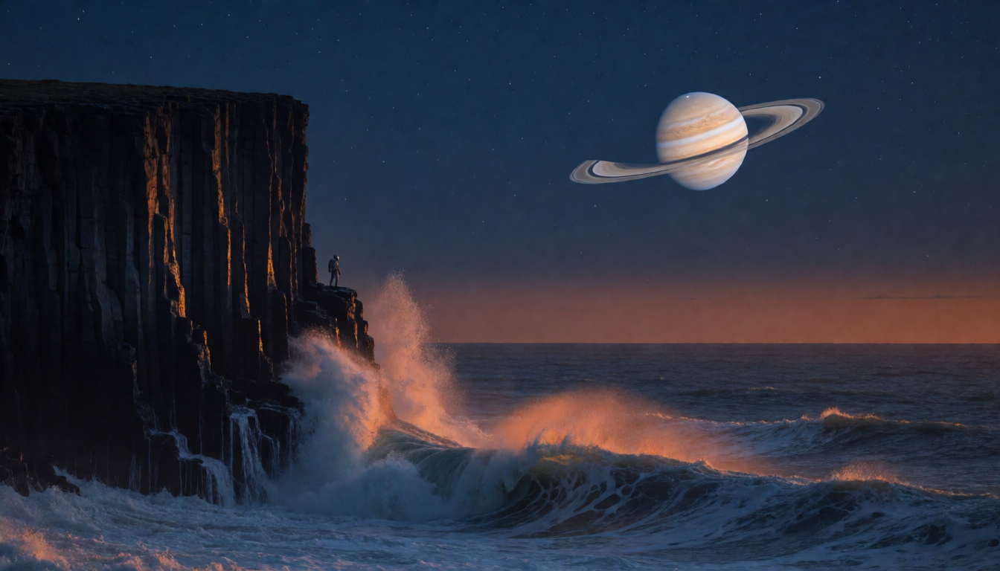
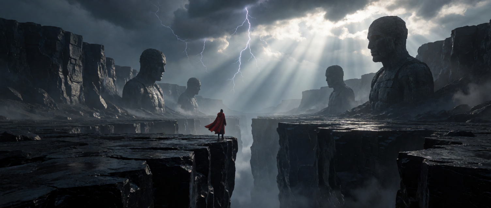

# Gallery

Both images use Turbo at eight steps. Seeds
are repeatable within this backend; output can change with kernel or runtime
revisions.



*1344×768, seed 64.*

<details>
<summary>Generation command</summary>

```sh
krea2 --width 1344 --height 768 --seed 64 --out planetrise.png \
  -p "Wide cinematic telephoto photograph taken twenty minutes after sunset, composed on the rule of thirds: the ringed planet's disc sits on the upper right third intersection, the sea horizon runs along the lower third line, the cliff edge falls on the left third line. Deep indigo sky overhead, darkening to a narrow band of burnt orange along the horizon, first stars showing high in the frame. An enormous ringed planet stands well clear above the sea with open uninterrupted sky between it and the horizon, still catching direct sunlight so it burns bright against the dark sky, its cloud bands sharply defined in cream and rust, the ring plane cutting a crisp dark shadow across its face. On the left a colossal fluted basalt sea cliff, its wet columns catching the last warm orange light along one edge and falling into deep blue shadow. A lone figure in a pale pressure suit on a ledge, tiny, backlit. A heavy ocean swell rolls in and breaks hard against the foot of the cliff, exploding into white spray that bursts up the rock face, long streaks of foam sweeping from the lower left corner across the water toward the planet, churning whitewater filling the bottom of the frame, wave crests catching the last orange light. Clean empty sky below the planet. Canon EOS R5, 300mm f/4, ISO 800, fast enough to freeze the spray, correct exposure holding both the bright planet and open shadow detail, fine grain, strong colour contrast between cool sky and warm rim light."
```

</details>



*1504×640, seed 9.*

<details>
<summary>Generation command</summary>

```sh
krea2 --width 1504 --height 640 --seed 9 --out canyon.png \
  -p "a lone figure in a red cloak standing at the edge of a vast obsidian canyon, colossal ancient statues half-buried in the far cliffs, storm light breaking through thunderclouds, volumetric god rays, cinematic wide shot, epic scale, photorealistic, fine detail"
```

</details>
